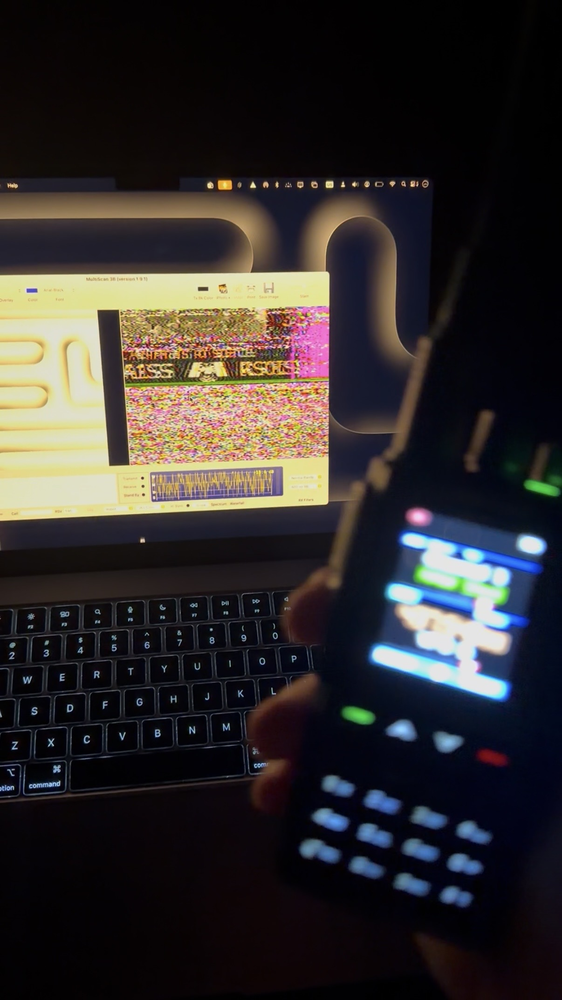
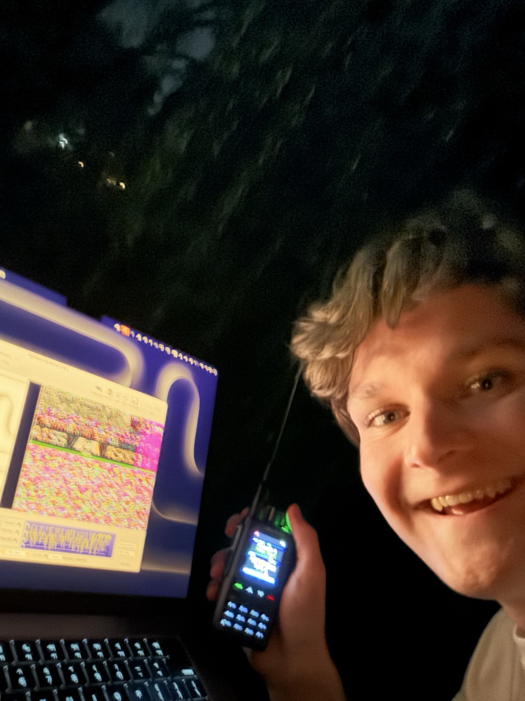
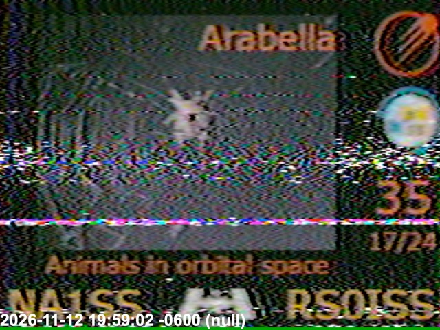
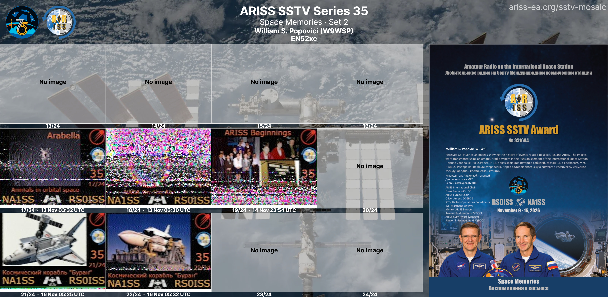

---
`RECENTLY`, I discovered the world of slow-scan television, or SSTV. For those not in the loop, it's basically pictures sent as analog sound via radio. 
The pictures I received were from the International Space Station, or ISS, and organized by <a class="" href="https://ariss.org">ARISS</a>.

I achived first light on November 10th of 2026, at 2010hrs. Below are the pictures of both my setup and my ecstatic self. Like below, I'm usually on top of a two-story-high playset or the shed to get a better reception.

My first *full* image came two days later, on November 12 at 1830hrs:

Since then, I went on to collect four (and a half...) images from ARISS Series 35 SSTV.

Now that I know how to receive it, SSTV is one of my favorite parts of the hobby! My setup was my Anytone HT recorded by a Sony voice recorder, then decoded using <a href="https://hamsoft.ca/pages/mmsstv-yoniq.php">MMSSTV-Yoniq</a>. Turns out all you need is a radio, a recorder, and a decoder. Any will do!

73 de W9WSP!